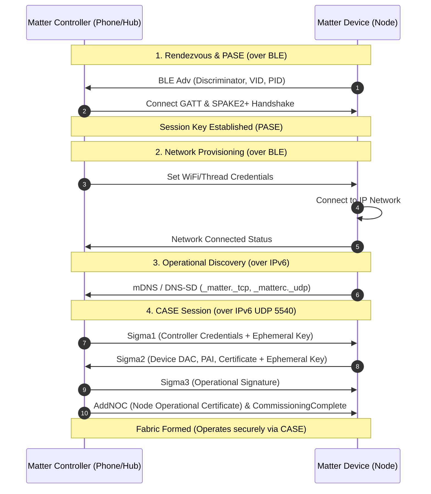

# Matter Standard Reference & Development Guide

## Overview
Matter (formerly Project CHIP / ConnectedHomeIP) is an open-source, royalty-free unified application layer and connectivity standard governed by the Connectivity Standards Alliance (CSA). It runs on top of IPv6 (Wi-Fi, Thread, Ethernet) and uses Bluetooth Low Energy (BLE) exclusively for commissioning.

Official Reference: [project-chip/connectedhomeip documentation](https://project-chip.github.io/connectedhomeip-doc/index.html)

---

## When to Use
- Implementing new Matter clusters (e.g. Door Lock, Occupancy Sensing, On/Off, Level Control).
- Architecting device endpoints, cluster handlers, and data model mappings.
- Configuring commissioning parameters (discriminator, passcode, setup payload, QR code).
- Debugging PASE, CASE, and MRP (Matter Message Reliability Protocol) exchanges.
- Writing or testing controllers using `chip-tool` or pure embedded stacks like `rs-matter`.

---

## Core Architecture

### 1. Data Model Hierarchy
```text
Node (Physical device on fabric)
 └── Endpoints (Numbered addressing units: 0 to N)
      ├── Endpoint 0: Root Node (System management clusters)
      └── Endpoint 1..N: Application Device Types (Door Lock, Sensor, Light)
           └── Clusters (Specific functional blocks, e.g., 0x0101 DoorLock)
                ├── Attributes (State variables, e.g., LockState, Occupancy)
                ├── Commands (Actions, e.g., LockDoor, UnlockDoor)
                └── Events (Timestamped state transitions, e.g., DoorStateChange)
```

### 2. Standard Endpoint Allocation
| Endpoint | Standard Function | Key Clusters |
|---|---|---|
| **Endpoint 0** | Root Node (Mandatory system infrastructure) | `BasicInformation` (0x0028), `Descriptor` (0x001D), `AccessControl` (0x001F), `GeneralCommissioning` (0x0030), `NetworkCommissioning` (0x0031), `OperationalCredentials` (0x003E) |
| **Endpoint 1** | Primary Device Type (e.g. Door Lock: `0x000A`) | `DoorLock` (0x0101), `Identify` (0x0003), `Descriptor` |
| **Endpoint 2** | Secondary Device Type (e.g. Occupancy Sensor: `0x0107`) | `OccupancySensing` (0x0406), `Identify` (0x0003), `Descriptor` |

---

## Commissioning & Protocol Lifecycle



### Key Phases:
1. **PASE (Password Authenticated Session Establishment):**
   - Cryptographic handshake using SPAKE2+ based on the device's Setup Passcode.
   - Typically executed over BLE GATT to safely bootstrap network credentials.
2. **Operational Discovery:**
   - Device connects to IP network and advertises operational identity via mDNS using its Compressed Fabric ID and Node ID: `<CompressedFabricID>-<NodeID>._matter._tcp.local`.
3. **CASE (Certificate Authenticated Session Establishment):**
   - Mutual certificate-based authentication using ECC (secp256r1).
   - Establishes encrypted unicast UDP sessions over port 5540.
4. **MRP (Matter Message Reliability Protocol):**
   - Matter's transport reliability protocol over UDP.
   - Provides acknowledgments, retransmissions, duplicate detection, and keep-alives.

---

## Setup Payloads & Test Credentials

### Standard Commissioning Codes:
- **Discriminator (12-bit):** Differentiates identical devices broadcasting BLE simultaneously (e.g. `3840` / `0x0F00`).
- **Passcode (27-bit):** Setup PIN (e.g. `20202021`).
- **Vendor ID (VID):** `0xFFF1` to `0xFFF4` reserved for testing and development.
- **Product ID (PID):** Vendor-defined 16-bit identifier.

### Generating Manual & QR Setup Codes
The Matter SDK uses base-38 encoding for QR codes (`MT:...`) and decimal for 11 or 21-digit manual pairing codes.
Using the official `chip-tool`:
```bash
# Generate setup payload string:
chip-tool payload generate-manual-code --discriminator 3840 --setup-pin-code 20202021 --version 0 --vid 0xFFF1 --pid 0x8000
```

---

## Implementation Patterns (rs-matter / Embedded)

### 1. Cluster Handler Structure
In decoupled architectures (e.g., Embassy / `rs-matter`), drivers must NOT directly couple to the global event bus. Instead, use callbacks for outbound notifications:

```rust
pub struct IntercomDoorLock<'a> {
    on_unlock: &'a dyn Fn(),
    lock_state: AtomicU8,
}

impl<'a> IntercomDoorLock<'a> {
    pub fn new(on_unlock: &'a dyn Fn()) -> Self {
        Self {
            on_unlock,
            lock_state: AtomicU8::new(0), // 0 = Not Fully Locked, 1 = Locked, 2 = Unlocked
        }
    }
}
```

### 2. Attribute Dirty Marking
Controllers use subscriptions to receive state updates. Whenever an attribute changes (e.g. lock unlocked or ring detected), notify the Matter stack so it generates a report:
- Mark the attribute dirty / trigger cluster change notification.
- In `rs-matter`, updates to cluster state inform the subscription engine to push MRP report frames to subscribed fabrics.

---

## Debugging with `chip-tool`

`chip-tool` is the reference Matter controller included in `project-chip/connectedhomeip`:

```bash
# Pair device over BLE with Wi-Fi credentials
chip-tool pairing ble-wifi <NODE_ID> <SSID> <PASSWORD> 20202021 3840

# Read attribute (e.g. LockState on Endpoint 1)
chip-tool doorlock read lock-state <NODE_ID> 1

# Send command (e.g. UnlockDoor on Endpoint 1)
chip-tool doorlock unlock-door <NODE_ID> 1

# Read Occupancy on Endpoint 2
chip-tool occupancysensing read occupancy <NODE_ID> 2

# Subscribe to occupancy attribute changes
chip-tool occupancysensing subscribe occupancy 1 30 <NODE_ID> 2
```

---

## Common Pitfalls & Checklist

| Pitfall | Root Cause | Solution |
|---|---|---|
| **"Too many retransmissions. Giving up"** | MRP packets unacknowledged over UDP 5540 due to dropped IPv6 packets or routing failure. | Verify IPv6 link-local reachability and check router multicast/NDP settings. |
| **Attribute change not updating in UI** | State changed in driver/actor but cluster attribute not updated or dirty bit not pulsed. | Ensure state is written to the cluster handler and subscription engine is notified. |
| **Aqara Hub / strict controller drops endpoint** | Missing global system attributes (`FeatureMap`, `AttributeList`). In `rs-matter`, omitting `system;` in `with_attrs(with!(...))` filters out `0xFFF8`..`0xFFFD`. | Always use `with!(system; AttributeId::... | ...)`. Ensure `FeatureMap` has required feature bits (e.g. PIR bit for Occupancy). |
| **Stack Overflow / Alloc Failure** | Matter crypto (SPAKE2+, ECDSA) and TLV encoding consume substantial stack/heap. | Ensure dedicated task stack size >= 8-12 KB; allocate sufficient heap for crypto exchange buffers. |
| **Device not re-pairing after firmware flash** | Old fabric credentials retained in non-volatile storage (NVS / Matter KVS). | Erase flash partition: `espflash erase-parts --port <PORT> matter_kvs nvs`. |
