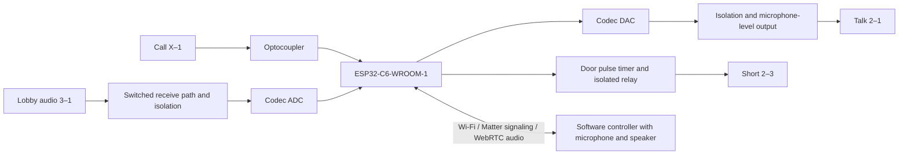

# IR204E replacement with ESP32-C6 and Matter audio

Revision D · 25 October 2026 · Current hardware design proposal

## Agreed scope

Replace the IR204E with a custom PCB using a bare ESP32-C6-WROOM-1 module. Connect directly to building terminals 1, 2, 3 and X. Ring notifications, listening, talking and door release are operated through software. There is no local microphone, speaker, chime or TALK/LISTEN/DOOR button assembly. BOOT/RESET service controls are retained for programming and recovery.

Use ESP32-C6-WROOM-1-N8 as the proposed 8 MB flash variant. The audio codec and isolation transformers remain necessary: they convert the building's analog lobby audio to digital network audio and back. The phone or other controller provides the resident's microphone and speaker.

This document replaces revisions A–C. It is a circuit proposal, not a released CAD schematic, PCB layout, tested installation or certified Matter device. The remaining engineering work is identified explicitly. No original-station bypass or local operational fallback is included. Without power, or without a working software/network path, this station cannot notify the resident, carry a conversation or initiate door release. Its normally open contacts release on power loss.

## System architecture



Three hardware blocks interface with the bus: an isolated call input, switched receive/transmit audio, and an isolated door-release contact. A separate 5 V supply powers everything. BUS_COM and ESP_GND must remain electrically separate, including through USB shields, mounting hardware and test instruments.

## Matter Audio Doorbell integration

The official Matter 1.5 data model defines Audio Doorbell as device type **0x0141**. It uses Identify, Switch, audio-enabled Camera AV Stream Management and WebRTC transport roles; its audio-only definition excludes video and snapshots. It also specifies Chime-client and root-node requirements. Implement the full requirements of the selected release, not just the device-type number. [Matter 1.5 Audio Doorbell definition](https://raw.githubusercontent.com/project-chip/connectedhomeip/master/data_model/1.5/device_types/AudioDoorbell.xml).

The AV model includes half-duplex talk and Opus audio. That matches the proposed one-direction-at-a-time analog routing. The names “microphone” and “speaker” describe the logical streams here: the capture source is lobby audio on terminal 3, and the playback destination is the lobby speaker reached through terminal 2. They do not require local acoustic transducers on this PCB. This mapping is the proposed integration design and needs controller/conformance validation. [Matter AV stream model](https://raw.githubusercontent.com/project-chip/connectedhomeip/master/data_model/1.5/clusters/CameraAVStreamManagement.xml).

Proposed endpoint plan:

| Endpoint | Purpose |
|---|---|
| 0 | Root node, commissioning, credentials and required supporting clusters |
| 1 | Audio Doorbell 0x0141: call event plus half-duplex audio session |
| Separate control endpoint, if supported by the chosen model | Authenticated momentary door-release request |

Door release is not automatically a capability of the Audio Doorbell endpoint. A Door Lock endpoint is a candidate, subject to its command/attribute conformance and controller behavior. This hardware has no physical lock or door-position feedback: do not report that the door is physically unlocked merely because a relay pulse was issued. Keep audio-session authorization and unlock authorization distinct. Receiving a call never unlocks automatically.

Use Wi-Fi for the media and Matter connection. Matter controls/signals the session; audio travels using the required WebRTC media transport, not as MQTT payloads or Matter attribute updates. Validate the selected controller's Audio Doorbell support, half-duplex user interaction, codec negotiation and chime/notification behavior. A general Matter-capable app is not proof that these functions are exposed.

**C6 firmware feasibility is a PCB-release gate.** Build a minimal combined Matter + audio-only WebRTC + Opus prototype and measure heap, task stacks, CPU load, reconnections and OTA margin. Espressif provides audio/WebRTC components, but its published Matter camera example uses a P4 plus a wireless companion; that is not evidence that this complete audio-only application runs on a C6 alone. Nor does it prove the C6 cannot do so. Keep the selected C6 target while testing it. The N8's extra flash is not extra working RAM. [Espressif WebRTC components](https://github.com/espressif/esp-webrtc-solution/blob/main/components/esp_peer/README.md), [Espressif Matter architecture](https://developer.espressif.com/blog/2026/01/introducing-esp-matter-camera/).

If the combined stack does not fit, review a media coprocessor or external gateway with the user before changing the hardware target. No compatibility with Apple Home, Google Home, Alexa or another particular controller is claimed by this proposal.

## Building connector and electrical assumptions

Provide one four-position screw terminal J_BUS, labelled 1, 2, 3, X. There is no J_STATION connector.

| Terminal | Net | Function |
|---|---|---|
| 1 | BUS_COM | Audio common, isolated from electronics ground |
| 2 | BUS_2 | Audio from apartment station to building amplifier |
| 3 | BUS_3 | Audio from building amplifier to apartment station |
| X | BUS_X | Apartment-selective call signal |

TekTone documents the audio wiring and 2–3 door-release closure. Its PK543A can require TALK before DOOR. Verify the actual amplifier model and interlock behavior; do not change shared amplifier settings. The report's exact voltages, oscillator frequency and 250 ms interlock timing are not verified installation data. [TekTone manual](https://www.tektone.com/pdf_files/manuals/IL826_PK543A_install.pdf), [TekTone FAQ](https://www.tektone.com/faqs/).

The provisional ring/receive envelope is 30 V peak during normal signaling. Talk-load DC current and dissipation require separate measurements. These limits are design assumptions, not a surge rating. The removed IR204E will no longer supply its speaker load across X–1: measure the call signal with the proposed detector alone. Do not automatically replace the speaker with a 45-ohm resistor; its dissipation could be substantial.

## Relay routing and drivers

Use three non-latching G6K-2P-Y DC5 DPDT signal relays. An SMT version can replace the through-hole package during layout after verifying its footprint and coil polarity. [Omron G6K datasheet](https://components.omron.com/sites/default/files/datasheet_pdf/K106-E1.pdf).

| Relay | Pole A | Pole B |
|---|---|---|
| K_GATE | COM = BUS_2; NO = GATED_2; NC unused | COM = BUS_3; NO = GATED_3; NC unused |
| K_MODE | COM = GATED_2; NO = TX_LINE; NC unused | COM = GATED_3; NC = RX_LINE; NO unused |
| K_DOOR | COM = BUS_2; NO = BUS_3; NC unused | Unused |

K_GATE opens both paths during idle and direction changes. K_MODE selects listen when de-energized and talk when energized. K_DOOR bypasses K_GATE so audio can be disconnected during release. K_ROUTE from the earlier attachment design is removed.

Each coil is powered from 5 V through a removable service jumper JP_COILS. Use a 2N3904 low-side driver, 680-ohm base resistor, 100k base-to-emitter pull-down and 1N4007 flyback diode, cathode to coil positive. Allocate 75 mA for the three coils plus margin. Add 100 nF and 100 microfarads on the switched coil rail. Remove JP_COILS for programming/bench work with the building wiring disconnected; it is not a resident control.

Use three channels of SN74LVC125A at 3.3 V, with 100 nF bypass. Inputs are GATE_CMD, MODE_CMD and the door timer's OUT, each with 100k pull-down. Outputs drive the three base resistors. Tie the fourth input to ground and leave its output unused. All output-enable pins connect to RELAY_OE_N, GPIO8 with a 10k pull-up. High disables all drivers. Initialize commands and timer trigger low, wait for stable startup, then arm only after successful initialization. [TI buffer](https://www.ti.com/product/SN74LVC125A).

## Hardware door pulse limiter

Use **LTC6993-1**, the rising-edge non-retriggerable version, at 3.3 V with 100 nF bypass. GPIO3 drives TRIG with a 100k pull-down. OUT feeds the door-driver buffer input and GPIO6 as DOOR_ACTIVE. GPIO6 observes the timer, not the physical lock.

Set R_SET to 383k, 1%, from SET to ground. Program DIVCODE 6 with 1.00M from 3.3 V to DIV and 681k from DIV to ground, both 1%. This selects positive output and divider 262144. The nominal pulse is 262144 × (383k/50k) × 1 microsecond = **2.008 seconds**, before component tolerances and relay release delay. [Analog Devices LTC6993 datasheet](https://www.analog.com/media/en/technical-documentation/data-sheets/LTC6993-6993-1-6993-2-6993-3-6993-4.pdf).

A static-high command cannot hold this one-shot active indefinitely. New edges during its pulse do not extend it. Firmware must still reject repeated requests during a cooldown; edges after the pulse can start another pulse. This circuit does not protect against welded contacts or a shorted transistor. RELAY_OE_N can disable the coil early. On reboot, wait for DOOR_ACTIVE to be low before arming the buffer.

## Ring detector

```text
BUS_X -- 1.5k / 0.5W -- bridge AC1
BUS_1 -- 1.5k / 0.5W -- bridge AC2
bridge + -- VO617A-3 LED anode
bridge - -- VO617A-3 LED cathode

3V3 -- 10k --+-- GPIO2 RING_N
            +-- optocoupler collector
optocoupler emitter -- ESP_GND
RING_N -- 1nF -- ESP_GND
```

Build the full-wave bridge from four 1N4007 diodes. There is no electrical connection across the optocoupler barrier. Approximate LED currents are 5.1 mA at 18 V peak and 7.7 mA at 26 V peak, using 2.8 V total semiconductor drop. At 30 V continuous input each series resistor dissipates approximately 0.123 W. Measure the call waveform with the old speaker removed and this detector connected before accepting these values. [Vishay VO617A](https://www.vishay.com/docs/83430/vo617a.pdf).

Use activity/envelope detection with an initial 50 ms validation window and 500 ms rearm interval. Do not require exactly 1 kHz: the installed tone may warble or differ from the report. A call event sends a notification; it never automatically starts transmitting or unlocks the door.

## Receive audio circuit

The receiver presents a light load to the listen line and attenuates the signal before the transformer.

```text
RX_LINE -- C_RX1 1uF/100V film -- R_RX1 47k/0.5W -- RX_PRI
RX_PRI -- R_RX2 1k -- BUS_COM
RX_PRI -- T_RX primary -- BUS_COM

T_RX secondary bottom -- ESP_GND
T_RX secondary top = RX_SEC
RX_SEC -- R_RX3 1k -- ESP_GND
RX_SEC -- C_RX2 1uF -- R_RX4 1k -- codec IN1_L
codec IN1_L -- C_RX3 470pF -- ESP_GND
```

T_RX is a TY-250P wired 1:1: primary pins 2–4; secondary pins 5–8 with 6 and 7 joined. Leave the primary center tap unconnected. Maintain the winding isolation boundary. Fit two BAT54H diodes in opposite directions across RX_SEC and ESP_GND to limit large secondary excursions before the coupling capacitor. These are signal limiters, not building surge arrestors.

An ideal 1:1 transformer with its 1k secondary termination reflects about 1k to the primary. In parallel with R_RX2, that is about 500 ohms. Thus nominal receive gain is 500/(47000+500), approximately 0.0105 or -39.6 dB, before winding losses and codec loading. A 30 V peak input gives about 0.316 V peak at the secondary before the limiter. This calculation is a starting estimate; transformer impedance and diode conduction are frequency- and amplitude-dependent.

Configure the codec for a single-ended input with its internal common-mode reference, initially 0 dB PGA gain. Increase gain after measuring real lobby audio; a typical commissioning range to explore is 20–40 dB. Never connect a fixed 1.65 V divider to this input. If the installed amplifier needs a native-speaker-like listen load, its value and dissipation must be measured and a switched load added; do not install an arbitrary permanent shunt across the riser.

The transformer is intended for speech-band operation here. Triad specifies TY-250P operation at input voltage no greater than 4.2 Vrms and current no greater than 7 mA for the listed alternate impedances. Verify both limits, actual response and distortion. [Triad TY-250P datasheet](https://catalog.triadmagnetics.com/asset/ty-250p.pdf).

## Transmit audio and talk detection

```text
codec LOL -- C_TX1 10uF nonpolar -- R_TX1 100 ohm -- T_TX primary top
T_TX primary bottom -- ESP_GND

T_TX secondary bottom -- BUS_COM
T_TX secondary top -- C_TX2 22uF/63V nonpolar -- R_TX2 4.7k -- TX_LINE
TX_LINE -- R_TALK 47 ohm / 5W provisional -- BUS_COM
```

Use a second TY-250P in the same 1:1 winding configuration. Configure LOL as a line output, keep the DAC digitally muted during switching, and begin with low playback gain. Do not use a class-D speaker output to drive this transformer.

R_TALK is deliberately on the bus side of C_TX2. It supplies the resistive talk-state load, while C_TX2 blocks DC from reaching the transformer. With a high-impedance amplifier input, the nominal pad gain is 47/(4700+47), approximately 0.00990 or -40.1 dB. A measured 2 Vpp on the transformer secondary would therefore produce about 19.8 mVpp, or 7 mVrms for a sine wave, at TX_LINE before further loading. The approximate capacitor corner is 1.5 Hz using 22 microfarads and 4747 ohms. Calibrate actual terminal voltage, rather than calculating it from DAC full scale.

The report describes a 45-ohm transducer, but its nominal impedance does not establish its DC resistance. **R_TALK is a commissioning-selected component:** compare its effect with the actual station in TALK before connecting it to the live system. Measure voltage across it, current, temperature and successful talk/door behavior. At 14 V DC across 47 ohms it would dissipate 4.17 W, already unsuitable for many enclosed 5 W resistor installations without thermal margin. If a voltage that high persists, stop and investigate; do not assume the report's floating bias voltage is a usable or harmless loaded voltage. Fit a higher rating or different value only from measurements and a thermal review.

Because this path has a DC termination, it can emulate more of the native talk behavior than the report's purely capacitor-coupled output. Whether it satisfies the installed talk interlock, and how long activation must precede DOOR, must still be verified. Do not claim a universal 250 ms delay. Remote release must remain disabled if interlock behavior cannot be reproduced reliably.

## Codec, clocks and power

Select TLV320AIC3204 for its ADC, DAC, programmable input gain and digital audio interface. Connect IN1_L for receive and LOL for transmit. Use I2C control with SPI_SELECT low. Provide IOVDD at 3.3 V, LDOIN at clean 3.3 V, and external AVDD and DVDD supplies at 1.8 V. Tie LDO_SELECT low and keep the internal analog LDO disabled. Bypass each supply pin locally; use a 10-microfarad REF capacitor. Follow TI's external-supply startup procedure. [TI datasheet](https://www.ti.com/lit/ds/symlink/tlv320aic3204.pdf), [TI application guide](https://www.ti.com/lit/ml/slaa557/slaa557.pdf).

Proposed supply tree:

```text
Isolated regulated 5V / 2A USB adapter
  +-- USB-C input protection and inrush control --> 5V board rail
  +-- TPS62162 buck --> 3V3_DIGITAL --> WROOM-1, relay buffer, logic
  +-- JP_COILS service jumper --> relay coils
  +-- TPS7A2033 --> 3V3_CODEC --> codec LDOIN
                    +-- TPS7A2018 --> 1V8_ANALOG --> AVDD
                    +-- TPS7A2018 --> 1V8_DIGITAL --> DVDD
3V3_DIGITAL --> codec IOVDD and I2C pull-ups
```

Use 1 microfarad minimum effective input/output capacitance for each proposed LDO, increasing output nominal capacitance to 4.7 microfarads to allow DC-bias derating; confirm capacitor requirements for the purchased package. Add 100 nF at codec supply pins. This separate regulation is a design choice intended to reduce radio and relay noise. [TPS7A20 family](https://www.ti.com/product/TPS7A20).

All 5 V branches are downstream of the same USB input stage. The UART service connector carries no power. Keep codec reset asserted and digital clocks stopped until supplies are stable. Fit a 10k reset pull-down. ESP_GND includes codec analog/digital returns; keep relay and radio currents out of analog return paths.

Proposed audio format is 16 kHz, 16-bit mono, carried in 32-bit stereo I2S slots with the unused channel zeroed. ESP32 is clock master: MCLK = 4.096 MHz, BCLK = 1.024 MHz, WCLK = 16 kHz. Configure codec dividers for that clock plan and the selected ADC/DAC processing blocks; verify the actual clocks and frame alignment during firmware bring-up. Keep TX and RX on the shared I2S clock pair.

For Opus/WebRTC, separately validate negotiated audio rates and RTP timing; the local I2S rate does not by itself define the network packet format. Keep unused codec channels and acoustic drivers powered down. No electret-bias, local microphone, speaker amplifier or acoustic output connector is populated.

## Module pad and GPIO assignment

These are WROOM-1 module pads, not bare-chip pins. Source: [Espressif module datasheet, Table 3-1](https://www.espressif.com/sites/default/files/documentation/esp32-c6-wroom-1_wroom-1u_datasheet_en.pdf).

| Module pad | GPIO | Connection |
|---|---|---|
| 1, 28, 29 | — | ESP_GND, including exposed pad |
| 2 | — | 3V3_DIGITAL |
| 3 | — | EN / reset network |
| 4, 5 | 4, 5 | Unused straps/JTAG; retain default states |
| 6 | 6 | DOOR_ACTIVE input from timer OUT; not lock feedback |
| 7 | 7 | K_GATE command through buffer |
| 8 | 0 | Codec SDA |
| 9 | 1 | Codec SCL |
| 10 | 8 | RELAY_OE_N; 10k pull-up; high disables |
| 11 | 10 | K_MODE command through buffer; high = TALK |
| 12 | 11 | Codec RESET_N; 10k pull-down |
| 13 | 12 | USB D− through 22 ohms |
| 14 | 13 | USB D+ through 22 ohms |
| 15 | 9 | BOOT button and 10k pull-up |
| 16 | 18 | I2S BCLK output |
| 17 | 19 | I2S WCLK output |
| 18 | 20 | I2S TX to codec DIN |
| 19 | 21 | I2S RX from codec DOUT |
| 20 | 22 | Codec MCLK output |
| 21 | 23 | Reserved; optional status LED through 1k to ESP_GND |
| 22 | — | NC; leave unconnected |
| 23 | 15 | Unused strap; retain default state |
| 24 | 17 | UART0 RX service pad |
| 25 | 16 | UART0 TX service pad |
| 26 | 3 | Door one-shot TRIG; default low, 100k pull-down |
| 27 | 2 | RING_N input |

Use 2.2k I2C pull-ups and initial 33-ohm source-series resistors on the five audio digital signals, including DOUT at the codec. GPIO8 is deliberately reused after boot; its pull-up preserves download-mode eligibility while disabling relays. GPIO6/7 are shared with pad JTAG: use native USB JTAG, and do not attach a pad-JTAG probe to live relay controls.

## Bare-module power and reset

Provide 3.3 V with at least 500 mA available to the module. The proposed TPS62162 fixed 3.3 V, 1 A buck uses a 2.2-microhenry shielded inductor, 10-microfarad input capacitor and 22-microfarad output capacitor following TI's reference circuit. Connect VIN and regulator EN to the protected 5 V rail, VOS to the output, FB to AGND, and both grounds and exposed pad to ESP_GND. Rate the inductor for worst-case peak current and allow for capacitor DC-bias loss. An adjustable regulator requires a different feedback network. [TI TPS62162](https://www.ti.com/lit/ds/symlink/tps62162.pdf).

Place an additional 10-microfarad and 100 nF capacitor at module pad 2. Connect EN to 3V3_DIGITAL through 10k and to ESP_GND through 1 microfarad; RESET grounds EN. Bring regulator PG to a test point with a 100k pull-up. Check the RC reset network against the actual power ramp; PG alone is not an independent brownout supervisor. The module includes the main crystal, flash and RF circuitry. [Espressif schematic guidance](https://docs.espressif.com/projects/esp-hardware-design-guidelines/en/latest/esp32c6/schematic-checklist.html).

GPIO9 has a 10k pull-up and BOOT button to ESP_GND. GPIO8 has its existing relay-enable pull-up. For recovery, remove JP_COILS, hold BOOT, tap RESET, release BOOT and program through native USB. Firmware must not arm relays in update or recovery mode.

## USB-C programming and supply input

Use one USB 2.0 Type-C receptacle for 5 V input and native USB Serial/JTAG. Join A6/B6 for D+ and A7/B7 for D− close to the connector. Route each through a low-capacitance TPD2EUSB30 ESD channel and a 22-ohm series resistor to module pads 14/13 respectively. Put ESD protection beside the connector and series resistors near the module. Provide unpopulated shunt-capacitor footprints. No USB-to-UART chip is required. [Espressif USB guidance](https://docs.espressif.com/projects/esp-hardware-design-guidelines/en/latest/esp32c6/schematic-checklist.html), [TPD2EUSB30](https://www.ti.com/product/TPD2EUSB30).

Connect CC1 and CC2 independently to ESP_GND through 5.1k resistors. Join VBUS contacts to the protected 5 V input and ground contacts to ESP_GND; leave SBU unused. Provide an input fuse footprint, initially evaluated at 1 A, with final rating based on measured load/inrush and wiring. Connect the shield to local electronics ground near the connector, never BUS_COM.

The input needs controlled inrush because downstream rails contain bulk capacitance. Include a slew-controlled input load-switch stage; finalize its device and timing against the chosen source and USB current budget during CAD implementation. Do not connect all bulk capacitance directly to VBUS and claim USB compliance. Keep connector-side capacitance within the applicable USB limit.

CC resistors identify a sink; they do not negotiate USB PD or authorize arbitrary current. Normal operation uses a known adequate isolated 5 V source. For computer programming, remove JP_COILS and keep audio/radio loads disabled until allowed host current and actual consumption are checked. No second power input is fitted, avoiding adapter/PC backfeed.

Provide a five-pad service header: ESP_GND, U0TXD, U0RXD, EN and GPIO9. Use 3.3 V UART logic and power through USB. Label TX/RX from the module's perspective.

## PCB floorplan and assembly

Use a four-layer PCB. Place WROOM-1 at an outer edge, preferably with its antenna projecting beyond the base board. Preserve the antenna keepout on every layer and the recommended enclosure clearance. Keep transformers, wiring, metal enclosure parts and screws away from the antenna. The N8 module is 18.0 by 25.5 mm; use the manufacturer's land pattern and exposed-pad treatment. [Module datasheet](https://www.espressif.com/sites/default/files/documentation/esp32-c6-wroom-1_wroom-1u_datasheet_en.pdf), [Espressif layout guidance](https://docs.espressif.com/projects/esp-hardware-design-guidelines/en/latest/esp32c6/pcb-layout-design.html).

Separate USB/power entry, MCU/digital audio, codec/transformer electronics-side terminals, and intercom connector/bus-side contacts. Keep regulator switching loops and coil returns away from the codec. Route USB as a short 90-ohm differential pair over a continuous local ground reference.

Use ESP_GND planes on the electronics side and a distinct BUS_COM area on the bus side. Clear all-layer copper across the isolation boundary, including beneath isolation components as their footprints require. No test pad, mounting hardware or ground fill may bridge it. Set creepage/clearance from final insulation and transient requirements; no certified safety rating is assigned here.

Use SMT codec/regulators on the final board; the selected through-hole transformers and relays can remain for first assembly. Provide test points for 5 V, 3.3 V, both 1.8 V rails, EN, RELAY_OE_N, RING_N, RX_SEC and TX_LINE, clearly separating the two ground domains. Keep R_TALK away from enclosure plastics and allow clearance based on measured heat. Final board outline and mounting holes require enclosure measurements.

## Operating states

Here 1 means an energized relay. Call detection is independent of audio selection.

| State | GATE | MODE | DOOR | Result |
|---|---:|---:|---:|---|
| Idle or boot | 0 | 0 | 0 | No audio load on terminals 2 or 3; ring detector monitors X |
| Session muted | 0 | Either | 0 | Both audio paths disconnected |
| Listen | 1 | 0 | 0 | Terminal 3 to ADC and software speaker |
| Talk | 1 | 1 | 0 | Software microphone to DAC and terminal 2 |
| Release pulse | 0 | Either | 1 | Terminals 2–3 bridged; audio disconnected |
| Power loss | 0 | 0 | 0 | Relays open; station functions unavailable |

For a direction change: mute audio, open GATE, wait for contacts to settle, change MODE, wait again, close GATE and ramp audio. Begin with 30 ms relay-settling delays and verify with the selected flyback network. Never switch relay direction at packet rate; the controller must provide a deliberate half-duplex turn-taking mechanism.

For release, complete any measured talk-interlock sequence first, then mute, open GATE and trigger the one-shot. Wait for DOOR_ACTIVE to go low and for relay release before restoring audio. The building amplifier controls the final strike timing. No physical door state is sensed.

An initial policy is one active audio session, a 60-second session limit and a two-second control/network-loss timeout. End the session on codec or transport failure. Disable drivers and return audio contacts to idle. Test MCU watchdog recovery; an independent hardware audio-session watchdog is not included. The separate door one-shot bounds an individual pulse but not repeated commands after rearming.

## Prototype bill of materials

| Group | Proposed parts |
|---|---|
| MCU | ESP32-C6-WROOM-1-N8 |
| Analog codec | TLV320AIC3204; no local microphone or speaker circuitry |
| Audio isolation | 2 TY-250P, wired 1:1 |
| Relays | 3 G6K-2P-Y DC5 non-latching DPDT |
| Drivers | SN74LVC125A; 3 2N3904; 3 x 680 ohm; 6 x 100k buffer/base pull-downs; 3 flyback 1N4007; 10k enable pull-up |
| Door timer | LTC6993-1; 383k, 1.00M and 681k at 1%; 100k trigger pull-down; 100nF bypass |
| Ring | VO617A-3; 4 bridge 1N4007; 2 x 1.5k/0.5W; 10k; 1nF |
| Receive | 1uF/100V film; 47k/0.5W; 3 x 1k; 1uF local coupling; 470pF; 2 BAT54H |
| Transmit | 10uF nonpolar; 100 ohm; 22uF/63V nonpolar; 4.7k; commissioning-selected R_TALK, initially evaluated at 47 ohm/5W |
| Codec power | TPS7A2033; 2 TPS7A2018; local bypass and REF capacitors |
| MCU power | TPS62162; 2.2uH; input/output capacitors; PG pull-up; module bypass |
| Service | BOOT/RESET; EN 10k/1uF; BOOT 10k; JP_COILS; five-pad UART header |
| USB | Type-C receptacle; 2 x 5.1k; TPD2EUSB30; 2 x 22 ohm; fuse; slew-controlled input stage finalized during CAD/inrush review |
| Digital support | 2 x 2.2k I2C pull-ups; codec reset 10k pull-down; 5 x 33-ohm audio series resistors |
| Building interface | One four-position screw terminal labelled 1, 2, 3, X |
| Supply | Separate isolated regulated 5V/2A source; coil rail 100nF and 100uF |

Local coupling/bypass capacitors need suitable voltage ratings and effective capacitance under bias; use at least 10 V ratings for ordinary electronics-side coupling capacitors. Transformer and relay sizes require an enclosure measurement before fixing board dimensions. This list is a prototype selection, not a procurement-ready CAD BOM with footprints and all decouplers enumerated.

## Validation before PCB release

1. Identify the amplifier and original station. Before removing it, record native TALK/LISTEN/DOOR behavior, speaker resistance and interlock behavior. Measure bus DC and audio levels using an isolated or differential instrument. Do not earth-reference BUS_COM with a scope ground clip.
2. Check call detection with the original speaker removed. Confirm that the optocoupler alone works and that an added load is actually necessary before designing any call-load resistor.
3. Test receive gain, limiter behavior and speech response from 300 Hz to 3.4 kHz, and transmit level/impedance into a representative load. Check R_TALK voltage, power and temperature. Validate interlock operation without accepting the report's timing estimates as guarantees.
4. Verify relay routing and idle isolation, plus absence of conduction between BUS_COM and ESP_GND. Scope startup, resets, flashing and brownout. Confirm RELAY_OE_N remains high until explicit arming.
5. Verify the door pulse with a held-high trigger, extra edges during a pulse, reboot during a pulse and rearming after completion. Measure contact release delay and reject unexpected repeated activation.
6. Prototype Matter Audio Doorbell with WebRTC/Opus on the C6 and the intended controller. Test half-duplex talk, ringing/notifications, authenticated release, simultaneous fabrics or requests, Wi-Fi loss, memory exhaustion and OTA. Establish working RAM/CPU margin before freezing this MCU-only PCB.
7. Validate USB current/inrush, both connector orientations, power-rail load transients and antenna performance in the final enclosure. Finalize input load-switch selection, protection, thermal clearance and mounting geometry.

Normal-voltage calculations do not establish building surge immunity. Define a transient target and coordinate series protection/clamps before fabrication. Do not apply the report's generic 24 V TVS recommendation to every shared audio line. Release requires the measured electrical envelope, chosen Matter SDK/controller, successful C6 feasibility prototype, completed CAD checks and layout review. No build or hardware verification has been performed in this design task.
