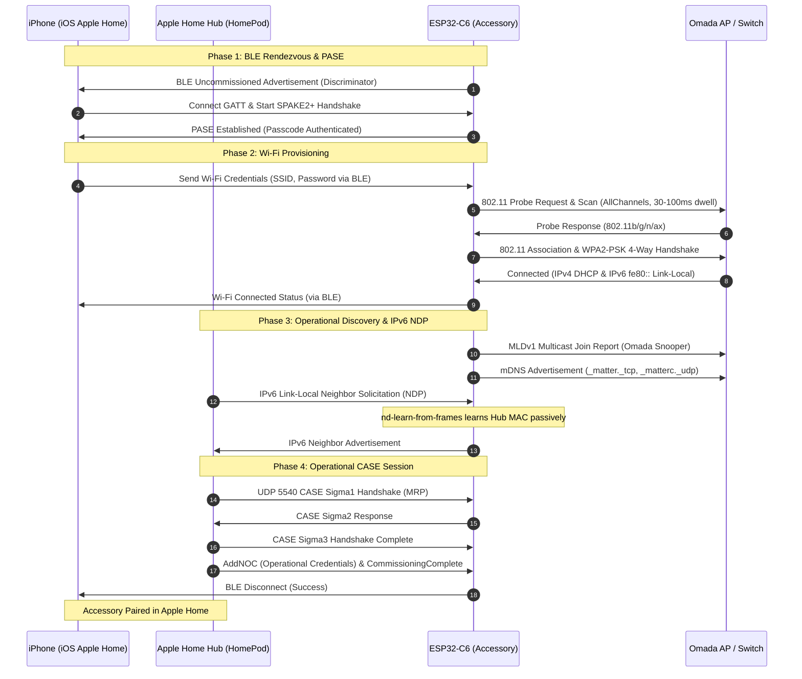

# Commissioning Troubleshooting & Technical Post-Mortem

**Device:** ESP32-C6 (DFRobot Beetle)  
**Target:** Apple Home (HomeKit) via Matter over Wi-Fi  
**Network Environment:** TP-Link Omada SDN (Wi-Fi 6 APs, ER605 Router, TL-SG2008P Switch)  
**Status:** **Resolved & Successfully Commissioned**

---

## 1. Executive Summary

Pairing an embedded `no_std` Rust Matter device running `esp-hal` + `esp-radio` + `rs-matter-embassy` into Apple Home in an enterprise/prosumer network environment (such as TP-Link Omada or Ubiquiti UniFi) involves tight interactions across four distinct protocol layers:

1. **Bluetooth Low Energy (BLE)** GATT connection & PASE session.
2. **802.11 Wi-Fi** scanning, authentication, and association.
3. **IPv6 Link-Local / Multicast (NDP & MLD)** address resolution.
4. **Operational Channel (CASE / MRP)** over UDP 5540 between Apple Home Hub (HomePod) and the device.

A breakdown in any one of these layers causes Apple Home to abort the setup with generic errors like `"Unable to Add Accessory"` or `"Connecting to Accessory..."` hanging indefinitely.

This document records the four technical root causes encountered during the commissioning of this project, the packet-level symptoms, and how each was permanently resolved in both `intercom-matter` and `rs-matter-embassy`.

---

## 2. Commissioning Architecture & Flow



---

## 3. Issues, Root Causes, and Fixes

### Issue 1: TP-Link Omada IPv6 Multicast / NDP Blackhole (The 37-Second Timeout)

#### Symptoms
- BLE PASE succeeded.
- ESP32-C6 connected to the Wi-Fi network (`192.168.1.119`), configured its link-local IPv6 address (`fe80::...`), and started operational mDNS advertising.
- The iPhone stayed on `"Connecting to Accessory..."` for exactly 37 seconds.
- Serial logs reported MRP retransmission failure:
  ```text
  [00:00:42.100] [DEBUG] rs_matter::transport::exchange: Too many retransmissions. Giving up
  [00:00:42.102] [ERROR] rs_matter_embassy::matter: Matter runner failed: Error(Network)
  [00:00:42.105] [DEBUG] esp_radio::ble: Disconnected: Remote User Terminated Connection
  ```
- Apple Home displayed `"Unable to Add Accessory"`.

#### Technical Root Cause
Apple Home Hubs (HomePods) communicate with Matter devices using IPv6 Link-Local (`fe80::...`) unicast over UDP port 5540.
1. Before the HomePod can transmit UDP packets to the ESP32-C6's link-local address, it must resolve its MAC address using IPv6 Neighbor Discovery Protocol (NDP). It sends a multicast **Neighbor Solicitation (NS)** to the device's solicited-node multicast group (`ff02::1:ffxx:xxxx`).
2. TP-Link Omada switches and APs enforce **MLD (Multicast Listener Discovery) snooping**. If the switch does not receive an MLD Join Report from a host for that multicast group, it prunes/drops multicast frames destined to that group.
3. The embedded `smoltcp` stack in `rs-matter-embassy` emits **MLDv2** reports. Omada hardware often fails to recognize MLDv2 without explicit MLDv1 backward-compatibility queries, resulting in dropped NDP multicast solicitations.
4. Furthermore, when the ESP32 needed to reply to the HomePod, it in turn needed to resolve the HomePod's MAC address using an NDP solicitation that was similarly dropped or unacknowledged.

#### Solution
Two features were engineered into `rs-matter-embassy` (`src/enet.rs`):
- `mld-v1-compat`: Rewrites multicast group memberships into MLDv1 join reports so Omada switches update their snooping tables.
- `nd-learn-from-frames`: Passively learns the peer's MAC address directly from the Ethernet frame headers of incoming IPv6 UDP frames, bypassing the need for a bidirectional NDP exchange.

**The Bug:** In `intercom-matter/Cargo.toml`, `rs-matter-embassy` was specified with `default-features = false`, omitting these two critical features!

**The Fix in `intercom-matter/Cargo.toml`:**
```toml
# Cargo.toml
[dependencies.rs-matter-embassy]
path = "../rs-matter-embassy/rs-matter-embassy"
default-features = false
features = [
    "esp-radio",
    "matter-wifi",
    "mld-v1-compat",        # <-- Omada MLDv1 compatibility
    "nd-learn-from-frames",  # <-- Opportunistic NDP resolution
]
```

---

### Issue 2: Wi-Fi Scan Beacon Misses & Channel Hop (`NoAccessPointFound`)

#### Symptoms
During BLE provisioning, the iPhone sent the SSID credentials, but the ESP32-C6 immediately failed with:
```text
[00:00:15.320] [INFO] wifi: Scan completed in 169ms, found 1 APs
[00:00:15.322] [INFO] wifi: DisconnectedInfo { reason: NoAccessPointFound, rssi: -128 }
```
The scan took only ~169 ms, returned 0 or 1 irrelevant AP (e.g. a printer on Channel 1), and failed to find the target AP even when located in the same room.

#### Technical Root Cause
1. **Dwell Time Too Short:** Default `ScanTypeConfig::Active` in `esp-radio` dwelled for only 10–20 ms per channel. Standard 802.11 access points broadcast beacons at 100 TU intervals (~102.4 ms). A 10–20 ms channel dwell time misses beacons with >80% probability.
2. **Single-Channel Fast Scan:** An optimization setting (`ScanMethod::Fast`) was active in `rs-matter-embassy`, which stopped scanning immediately after Channel 1 if any AP was seen, failing when the target SSID operated on Channel 6 or 11.

#### Solution
In `rs-matter-embassy/src/wifi/esp.rs`:
1. Switched scanning method to `ScanMethod::AllChannels`.
2. Increased active scan dwell times to `min: 30ms, max: 100ms`:
```rust
let scan_config = ScanConfig {
    scan_type: ScanTypeConfig::Active {
        min: esp_radio::wifi::DwellTime::from_millis(30),
        max: esp_radio::wifi::DwellTime::from_millis(100),
    },
    show_hidden: true,
    scan_method: ScanMethod::AllChannels,
    ..Default::default()
};
```
3. Added diagnostic logging displaying all discovered APs, RSSI, channels, and security types.

---

### Issue 3: Wi-Fi 6 / 802.11ax Protocol Incompatibility

#### Symptoms
In environments with Wi-Fi 6 APs (such as Omada EAP610 / EAP650) with 802.11ax enabled on 2.4 GHz, probe requests were ignored or rejected during association.

#### Technical Root Cause
The station client configuration in `esp-radio` explicitly specified protocols:
```rust
client_config.protocols = Protocol::B | Protocol::G | Protocol::N;
```
Even though the ESP32-C6 hardware supports 802.11ax, `Protocol::AX` was omitted from the client capabilities mask. When connecting to an 802.11ax AP with OFDMA enabled, association negotiations failed.

#### Solution
In `rs-matter-embassy/src/wifi/esp.rs`:
Added `Protocol::AX` to station capabilities for both scan and client association:
```rust
client_config.protocols = Protocol::B | Protocol::G | Protocol::N | Protocol::AX;
```

---

### Issue 4: WPA3-Personal (SAE) vs WPA2-Personal (PSK)

#### Symptoms
When initiating pairing with the iPhone connected to the primary home Wi-Fi SSID (`MyHomeNetwork`), the ESP32 log showed:
```text
wifi: DisconnectedInfo { reason: NoAccessPointFoundWithCompatibleSecurity, rssi: -128 }
```

#### Technical Root Cause
- Apple Home automatically provisions the accessory with the Wi-Fi credentials of whatever network the commissioning iPhone is currently connected to (there is no manual network picker in standard Apple Home pairing).
- The primary home SSID (`MyHomeNetwork`) was configured with WPA3-Personal (SAE) / Transition mode.
- The `esp-radio` station mode driver does not currently support WPA3-SAE handshakes in `no_std`.

#### Solution
- The commissioning iPhone **must be connected to the dedicated 2.4 GHz WPA2-Personal network** (e.g. `MyHomeNetwork_IoT`) prior to tapping "Add Accessory" in Apple Home.

---

## 4. Key Commits & Code References

| Repository | Commit | Description |
|------------|--------|-------------|
| `intercom-matter` | `ee30746` | Enabled `mld-v1-compat` and `nd-learn-from-frames` in `Cargo.toml`; enabled debug logging in `main.rs`. |
| `rs-matter-embassy` | `7befe36` | Added `Protocol::AX` support, `ScanMethod::AllChannels`, and 30–100ms active scan dwell time in `src/wifi/esp.rs`. |

---

## 5. Network Configuration Best Practices (Omada / UniFi)

For reliable Matter over Wi-Fi commissioning on TP-Link Omada or similar SDN setups:

1. **Dedicated 2.4 GHz IoT SSID:**
   - Security: **WPA2-PSK (AES)**. Avoid WPA3-SAE on the IoT SSID.
   - Frequency: 2.4 GHz only (disable 5 GHz on this SSID to prevent steering issues).
2. **Multicast & MLD Settings:**
   - **Enable IGMP Snooping** and **MLD Snooping** on all VLANs and switches.
   - **Disable** `"Block LAN to WLAN Multicast and Broadcast"`.
   - **Disable** `"Multicast Enhancement (IGMP to Unicast)"` if available, or ensure mDNS (`224.0.0.251` / `ff02::fb`) and NDP (`ff02::1:ffxx:xxxx`) are exempt.
3. **Commissioning Device:**
   - Make sure your iPhone / iPad is on the IoT Wi-Fi network before opening Apple Home to pair the accessory.
   - Ensure the Apple Home Hub (HomePod or Apple TV) has mDNS / IPv6 access to the IoT network (either same subnet/VLAN or mDNS repeater enabled).

---

## 6. Verification Checklist

When commissioning a newly flashed device or troubleshooting pairing:

- [ ] Connect iPhone to `MyHomeNetwork_IoT` (WPA2 2.4 GHz).
- [ ] Connect serial monitor without resetting board (`python3 scripts/monitor.py --no-reset`).
- [ ] Check BLE advertising: `Matter controller is not commissioned. Starting BLE...`
- [ ] Scan QR code / enter setup code in Apple Home.
- [ ] Verify BLE PASE completes: `PASE complete`.
- [ ] Verify Wi-Fi scan finds target AP (`MyHomeNetwork_IoT`, ch 1/6/11, RSSI > -75 dBm).
- [ ] Verify Wi-Fi connects: `wifi: Connected: ConnectedInfo { ... }` and obtains IP.
- [ ] Verify mDNS starts: `Starting mDNS advertising...`.
- [ ] Verify Hub initiates CASE over IPv6 Link-Local UDP 5540.
- [ ] Verify `CommissioningComplete` received and BLE terminates cleanly.
- [ ] Verify accessories appear in Apple Home: Intercom Lock (Door Lock) + Ring Sensor (Motion Sensor).

---

## 7. Agent Operations Cheat Sheet: Run, Reset, Debug & Monitor

### 1. Run & Build
```bash
# Build the firmware targeting RISC-V ESP32-C6
mise exec -- cargo build

# Build + flash + monitor (using .cargo/config.toml runner)
mise exec -- cargo run

# Flash a pre-built binary directly
espflash flash target/riscv32imac-unknown-none-elf/debug/intercom-matter --port /dev/cu.usbmodem14201
```

### 2. Monitor Live Logs (Without Rebooting)
Opening standard serial terminals (`screen`, `picocom`, `espflash monitor`) asserts DTR/RTS and resets the ESP32-C6, wiping active state. Use `scripts/monitor.py`:
```bash
# Non-intrusive live log streaming (preserves running state)
python3 scripts/monitor.py --no-reset

# Stream background log file directly:
tail -f /tmp/intercom_serial.log
```

### 3. Reset Hardware & Matter Fabric
- **Soft Reboot:** Tap `RST` button on the board, or run `python3 scripts/monitor.py` without flags.
- **Factory Reset Commissioning Only (Recommended to re-pair without reflashing):**
  ```bash
  espflash erase-parts --port /dev/cu.usbmodem14201 matter_kvs nvs
  ```
  After wiping `matter_kvs` and `nvs`, reboot the board. It will boot cleanly into uncommissioned mode with BLE advertising enabled.
- **Bootloader / Download Mode:**
  If serial hangs or USB does not enumerate: Hold `BOOT` (GPIO9) -> tap `RST` -> release `BOOT`.
- **Full Flash Wipe (Complete erase):**
  ```bash
  espflash erase-flash --port /dev/cu.usbmodem14201
  ```

### 4. Debugging & Verbosity
In `src/main.rs`:
```rust
uptime_logger::init(log::LevelFilter::Debug); // LevelFilter::Info, Debug, or Trace
```
Key logs:
- `rs_matter::transport::exchange` — MRP retry count, ACKs, packet delivery
- `wifi: Scan completed`, `wifi: Connected` — 802.11 association and IP state
- `Starting BLE`, `PASE complete` — Commissioning handshake progress
