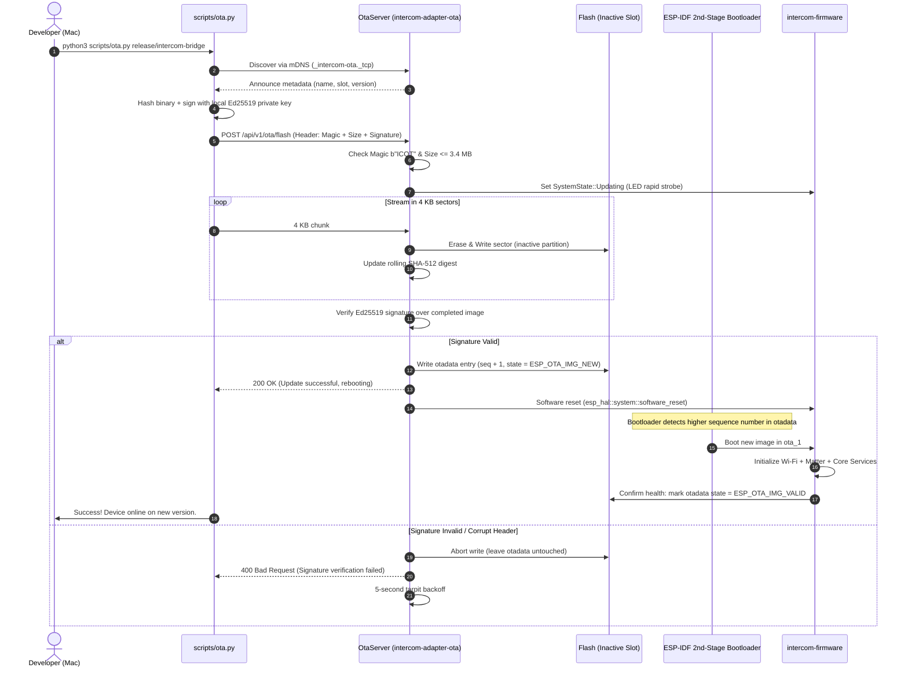

# Remote Firmware Updates (OTA) Design Specification

**Date:** 2026-10-14  
**Status:** Approved  
**Hardware Target:** ESP32-C6-WROOM-1-N8 (8 MB Quad SPI Flash)  
**Protocol:** Matter over Wi-Fi (Apple Home) + Out-of-Band Encrypted Local OTA  

---

## 1. Overview & Objectives

The Smart Intercom Bridge controls physical building access (door strike relay and analog ring detection) via Matter over Wi-Fi, paired with Apple Home. 

Because Apple Home does not permit users to sideload or deliver custom firmware binaries for uncertified Matter accessories, firmware updates must be delivered out-of-band over local Wi-Fi.

This specification outlines the architecture, security guarantees, flash memory layout, network protocol, and host tooling for zero-touch remote firmware updates (Over-The-Air / OTA).

### Key Goals
1. **Zero Wires Needed**: Wirelessly flash new firmware releases to intercom units mounted in door stations over Wi-Fi.
2. **Multi-Device Support**: Discover and selectively flash multiple intercom units on the same network (e.g. "Front Door", "Back Gate") without manual IP tracking.
3. **Cryptographic Protection**: Enforce Ed25519 asymmetric signature verification on all uploaded firmware. Reject any unauthorized image before committing to bootloader.
4. **Denial-of-Service (DoS) Resilience**: Maintain zero heap allocations for incoming OTA data, throttle connections, and ensure door unlock and ring interrupts strictly preempt OTA transfers.
5. **Fail-Safe Automatic Rollback**: Dual-bank A/B partitioning with ESP-IDF bootloader rollback ensures power outages or firmware panics on boot never brick the physical device.
6. **Matter Credential Preservation**: Matter fabric and commissioning data partition (`matter_kvs`) remains isolated and untouched across updates.

---

## 2. Flash Memory Architecture (8MB N8 Layout)

The target hardware is the ESP32-C6-WROOM-1-N8 module featuring **8 MB (8,388,608 bytes)** onboard SPI flash.

### Partition Table Layout (`partitions.csv`)

```csv
# Name,       Type, SubType, Offset,   Size,     Flags
nvs,          data, nvs,     0x9000,   0x6000,   # 24 KB (System / Wi-Fi NVS)
otadata,      data, ota,     0xf000,   0x2000,   # 8 KB (ESP-IDF bootloader slot state)
ota_0,        app,  ota_0,   0x20000,  0x350000, # 3.4 MB (App Slot A)
ota_1,        app,  ota_1,   0x370000, 0x350000, # 3.4 MB (App Slot B)
matter_kvs,   data, nvs,     0x6c0000, 0x6000,   # 24 KB (Matter fabrics & crypto keys)
```

### Partition Sizing Justification
* **App Slot Capacity (3.4 MB each)**: The current production release build occupies ~1.9 MB (`2,022,272 bytes`). Sizing each slot to 3.4 MB provides over **1.4 MB of free headroom per slot** for future features and debug logging.
* **`otadata` (8 KB = 2 sectors)**: Stores duplicate, CRC-checked `esp_ota_select_entry_t` structures tracking the active sequence number and validation state (`ESP_OTA_IMG_NEW`, `ESP_OTA_IMG_VALID`, `ESP_OTA_IMG_INVALID`).
* **`matter_kvs` (24 KB = 6 sectors)**: Preserved at fixed offset `0x6c0000`. Updating from `ota_0` to `ota_1` leaves Matter fabric pairings 100% intact.

---

## 3. Cryptographic Security & Anti-DoS Design

The intercom controls physical security (door strike relay). Security must withstand hostile devices on the local Wi-Fi.

### 3.1 Asymmetric Ed25519 Signing
* **No Shared Secrets on Device**: Eliminates pre-shared tokens or passwords that could be intercepted or misconfigured.
* **Key Generation**: An Ed25519 key pair is generated once on the developer's workstation:
  * Private key (`~/.intercom/ota_key.pem`) remains exclusively on the developer machine.
  * Public key (`[u8; 32]`) is embedded as a compile-time constant in `crates/intercom-adapter-ota`.
* **Payload Structure**:
  ```text
  +-------------------+----------------------+------------------------+-------------------------------+
  | Magic (4 bytes)   | Image Size (4 bytes) | Signature (64 bytes)   | Firmware Binary (N bytes)     |
  | b"ICOT"           | u32 little-endian    | Ed25519 Signature      | ESP32-C6 Image Format         |
  +-------------------+----------------------+------------------------+-------------------------------+
  ```
* **Verification Logic**:
  * As bytes stream in, the device computes SHA-512 over the firmware binary.
  * At EOF, the device validates the 64-byte Ed25519 signature against the embedded public key.
  * If signature validation fails, the target partition is discarded and `otadata` is **never updated**.

### 3.2 Anti-DoS & Resource Exhaustion Defense
1. **Zero Dynamic Allocations**: The OTA server uses a single static 4 KB buffer (`static SECTOR_BUFFER: StaticCell<[u8; 4096]>`). Network packets are streamed directly into this buffer and flushed to flash. Memory overhead is strictly bounded at 4 KB regardless of payload size.
2. **Single Concurrency Limit**: The TCP listener accepts exactly 1 connection. Any simultaneous connection attempts are immediately closed at the TCP layer.
3. **Fail-Fast Early Rejection**: The server inspects the first 72 bytes (magic header + length + signature) and the initial ESP32 image header (magic `0xE9`). If invalid, the connection is instantly aborted with `400 Bad Request` without erasing any flash sectors.
4. **Rate Limiting & Tarpit**: On any connection abortion or validation failure, the listener enforces a mandatory 5-second silence period before accepting subsequent connections.
5. **Core Priority Preemption**: Ring optocoupler interrupts and door unlock commands run on high-priority Embassy channels. The OTA streaming task yields asynchronously (`Timer::after_millis(1).await`) between sector writes, guaranteeing that door actuation is never blocked.

---

## 4. Multi-Device Discovery & Addressing

Multiple intercoms (e.g. Front Door, Back Gate, Service Entry) may operate on the same Wi-Fi subnet.

### 4.1 mDNS Service Advertisement
Each intercom advertises an mDNS service via Embassy:
* **Service Type**: `_intercom-ota._tcp.local`
* **Default Port**: `8080`
* **Hostname**: Derived from Wi-Fi MAC address: `intercom-<last-4-hex-mac>.local` (e.g. `intercom-84fc.local`)
* **TXT Records**:
  * `name`: Human-readable device name (e.g. `"Front Door Intercom"`)
  * `mac`: Full MAC address (`"34:85:18:0A:84:FC"`)
  * `sw_ver`: Current running software version (`"0.1.0"`)
  * `slot`: Active partition (`"ota_0"` or `"ota_1"`)

### 4.2 CLI Discovery & Selection Flow
The host CLI tool (`scripts/ota.py`) scans for `_intercom-ota._tcp.local` records:
* **Single Device**: If only one device is detected, it displays target details and proceeds.
* **Multiple Devices**: Displays an interactive selection menu:
  ```text
  Scanning local network for Intercom units...
  Found 2 devices:
    [1] Front Door (intercom-84fc.local - 192.168.1.142) [v0.1.0, running ota_0]
    [2] Back Gate  (intercom-9a12.local - 192.168.1.189) [v0.1.0, running ota_1]
    [A] All devices (sequential update)

  Select target [1-2, A]:
  ```
* **Direct Targeting**: Supports `--target <ip|hostname|name|mac>` to bypass interactive prompts in CI or automated deployment scripts.

---

## 5. Software Architecture & Crate Organization

The OTA implementation adheres strictly to the existing Ports & Adapters (Hexagonal) architecture:

```
crates/
├── intercom-core/
│   └── src/events.rs                # SystemState::Updating lifecycle variant
├── intercom-adapter-gpio/
│   └── src/led.rs                   # LED indicator stroboscopic pattern for Updating
├── intercom-adapter-ota/            # NEW: OTA Edge Adapter
│   ├── Cargo.toml
│   └── src/
│       ├── lib.rs                   # Public exports: OtaServer, OtaConfig
│       ├── server.rs                # Async HTTP/TCP listener on port 8080 (Embassy net)
│       ├── writer.rs                # Sector-by-sector flash writer & Ed25519 signature validator
│       └── bootloader.rs            # otadata reader/writer (ESP-IDF boot state transitions)
└── intercom-firmware/
    └── src/
        ├── main.rs                  # Composition root: starts OtaServer in embassy_futures::join
        └── config.rs                # Partition offsets and embedded Ed25519 public key
```

### System Lifecycle Integration
* When an OTA transfer begins, the server dispatches `SystemState::Updating` to the `SystemStateSender`.
* The `GpioLedDriver` observes this transition and drives the active-low LED in a rapid 10 Hz strobe pattern, visually indicating that an update is in progress.
* Once the update completes or fails, the state transitions back to `SystemState::Ready` or triggers reboot.

---

## 6. End-to-End Flash & Rollback Pipeline



### Fail-Safe Bootloader Rollback Guarantee
If new firmware contains a fatal bug causing early panics, boot-loops, or Wi-Fi initialization crashes:
1. The new image boots with `otadata` state set to `ESP_OTA_IMG_NEW`.
2. Because it crashes before executing `ota_mark_valid()`, the boot counter increments.
3. Upon reaching the boot attempt limit, the ESP-IDF bootloader marks the slot `ESP_OTA_IMG_INVALID` and **automatically boots back into the previously active slot**.
4. The intercom remains operational on the older firmware version, completely preventing wall-mounted bricking.

---

## 7. Host Tooling & Workflow

### 7.1 Key Generation (`scripts/generate_keys.py`)
Generates the developer's Ed25519 signing key:
```bash
python3 scripts/generate_keys.py
# Outputs:
#   Private key: ~/.intercom/ota_key.pem (mode 0600)
#   Public key:  Embeddable Rust byte array for config.rs
```

### 7.2 Flashing Tool (`scripts/ota.py`)
Single-command deployment from macOS:
```bash
# Auto-detect device via mDNS, sign, and flash:
python3 scripts/ota.py target/riscv32imac-unknown-none-elf/release/intercom-bridge

# Specify target device explicitly:
python3 scripts/ota.py --target "Front Door" target/riscv32imac-unknown-none-elf/release/intercom-bridge
python3 scripts/ota.py --target intercom-84fc.local target/riscv32imac-unknown-none-elf/release/intercom-bridge
```

---

## 8. Verification & Testing Strategy

1. **Host Unit Tests (`intercom-adapter-ota`)**:
   * Test Ed25519 signature verification with valid and corrupted payloads.
   * Test rolling SHA-512 calculation over chunked byte streams.
   * Test `otadata` sequence calculation, CRC validation, and active slot toggling using mock in-memory flash.
2. **Anti-DoS Verification**:
   * Send unauthenticated and corrupted streams; verify zero panics, immediate connection drops, and zero flash writes.
   * Verify concurrent connection rejection.
3. **End-to-End Integration Test**:
   * Flash v0.1.0 via USB cable.
   * Wirelessly push v0.2.0 via `scripts/ota.py`.
   * Verify Apple Home connection persists uninterrupted (no re-commissioning).
   * Verify LED transitions: `Connected` $\rightarrow$ `Updating` (strobe) $\rightarrow$ `Connecting` $\rightarrow$ `Ready`.
   * Test simulated boot failure: verify automatic rollback to v0.1.0.
